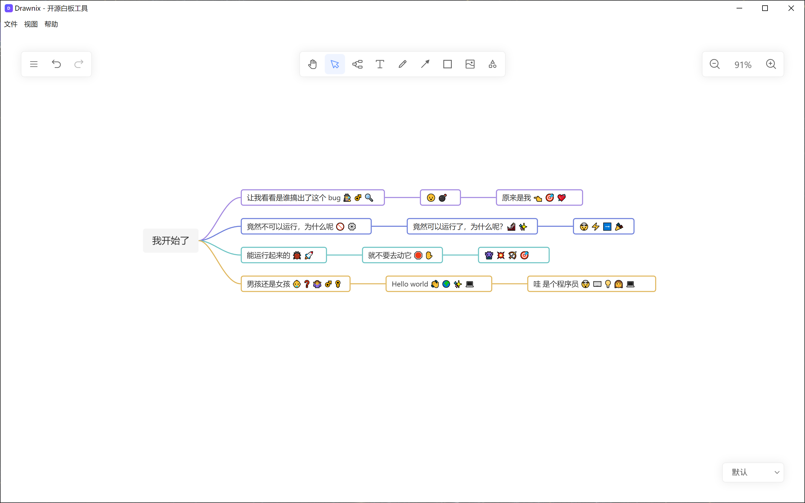

# Drawnix Windows 桌面版

把开源白板工具 [Drawnix](https://github.com/plait-board/drawnix) 封装成 Windows 10/11 x64 桌面客户端：双击安装、离线可用、`.drawnix` 文件双击即开，无需浏览器。

> 渲染层直接复用 Drawnix 官方构建产物，本项目只提供 Electron 桌面壳与桌面能力适配（原生打开/保存对话框、导出落盘、外链交给系统浏览器）。



## 下载

前往 [Releases](https://github.com/andloo/drawnix-windows-desktop/releases/latest) 下载：

| 文件 | 说明 |
| --- | --- |
| `Drawnix-<version>-x64-Setup.exe` | 安装版：可选安装目录，创建桌面/开始菜单快捷方式，注册 `.drawnix` 文件关联 |

系统要求：Windows 10 1809+ / Windows 11，x64。

> 当前安装包**未做代码签名**，首次运行时 Windows SmartScreen 会提示"未知发布者"，选择「更多信息 → 仍要运行」即可。

## 功能

- 思维导图、流程图、自由画笔、形状/箭头/文本、图片插入
- 无限画布：缩放、滚动、主题切换
- Mermaid 语法转流程图、Markdown 转思维导图（全部本地打包，离线可用）
- 撤销/重做/复制/粘贴，导出 PNG / SVG，复制选区为图片
- 原生文件操作：打开、保存（Ctrl+S）、另存为（Ctrl+Shift+S）、导出时弹原生保存对话框
- 保存结果提示：成功显示文件路径，失败显示原因
- 自动保存到本地（IndexedDB），崩溃/重启后可恢复
- 单实例运行 + 文件关联：双击 `.drawnix` 直接打开，重复启动复用已有窗口
- 外链一律交给系统默认浏览器，应用内不打开新窗口

## 使用

1. 运行 `Drawnix-<version>-x64-Setup.exe` 完成安装。
2. 从开始菜单或桌面启动 **Drawnix**。
3. 首次启动会显示引导提示；直接开始绘制即可，内容会自动保存在本地。
4. 需要留存文件时使用「应用菜单 → 另存为」，或按 `Ctrl+Shift+S`；之后 `Ctrl+S` 直接覆盖当前文件。

数据位置：

- 画板自动保存：`%APPDATA%\Drawnix\`（IndexedDB，卸载默认保留）
- 手动保存的文件：你选择的任意路径，扩展名 `.drawnix`（JSON 格式，可跨平台导入 Web 版）

应用不发起任何外部网络请求（已移除统计脚本与 SEO 资源）。

## 从源码构建

环境要求：Node.js 20+、npm、Windows x64。

```bash
# 1. 安装依赖（Electron 二进制下载慢时可设置镜像）
npm ci
# PowerShell: $env:ELECTRON_MIRROR="https://npmmirror.com/mirrors/electron/"

# 2. 开发模式（需要先启动 Drawnix Web 开发服务器 http://localhost:7200）
npm run electron:build
npx electron .            # 或在上游仓库根目录执行 npm run start

# 3. 打包 Windows 安装包
npm run dist:win
# 产物：release/Drawnix-<version>-x64-Setup.exe
```

`npm run dist:win` 会依次执行：

1. `sync:web`：如有上游 Drawnix 仓库的构建产物则同步到 `dist/apps/web`；独立克隆时沿用仓库中已提交的预构建产物
2. `electron:build`：用 esbuild 编译 `electron/main.ts` 与 `electron/preload.ts` 到 `electron/dist`
3. `electron-builder --win --x64`：生成 NSIS 安装包

> 桌面适配层（`window.drawnixDesktop` 桥接、CSP、原生打开/保存流程）只存在于预构建产物中，普通上游构建不含这些改动。因此 `sync:web` 会先校验上游产物，缺少适配标记时默认拒绝覆盖并退出，避免打包出失去桌面能力的安装包；确认要强制覆盖时执行 `npm run sync:web -- --force`。替换采用「暂存 → 校验 → 备份 → 原子替换」，失败会自动回滚。也可随时单独校验产物：`npm run verify:web`。

重新生成图标（可选）：

```powershell
powershell -ExecutionPolicy Bypass -File scripts/make-icons.ps1
```

## 目录结构

```
.
├── electron/
│   ├── main.ts                 # 主进程：窗口、app:// 协议、IPC、菜单、单实例、文件关联
│   ├── preload.ts              # contextBridge 白名单 API
│   └── tsconfig.json
├── scripts/
│   ├── sync-web.js             # 同步渲染层产物到 dist/apps/web（校验 + 原子替换 + 回滚）
│   ├── check-web-build.js      # 校验渲染层产物是否包含桌面适配层
│   └── make-icons.ps1          # 生成多尺寸 ico
├── build/
│   ├── icon.ico                # 应用图标
│   └── file.ico                # .drawnix 文件关联图标
├── dist/apps/web/              # 预构建的渲染层（Drawnix + 桌面适配）
├── electron-builder.yml        # NSIS x64 打包配置
└── package.json
```

## 架构说明

```
Drawnix.exe (NSIS 安装包)
└── 主进程 (Electron / Node)
    ├── app://bundle 自定义安全协议 → 提供 dist/apps/web 静态资源
    ├── 原生 dialog + fs：打开/保存/另存为/导出
    ├── 单实例 & .drawnix 文件关联（argv 解析 + 渲染层握手）
    └── IPC（contextBridge 白名单）
        └── 渲染进程：Drawnix SPA（React 19 + Plait）
            └── IndexedDB 自动保存
```

关键设计：

- **不使用 `file://` 加载页面**：`file://` 的 null origin 会导致 IndexedDB、剪贴板 API 失效，且 `<base href="/">` 的绝对路径会断链。因此注册 `app://`（`standard: true, secure: true`）承载页面。
- **进程隔离**：`contextIsolation: true`、`sandbox: true`、`nodeIntegration: false`，渲染层只能调用 preload 暴露的白名单方法。
- **原生文件能力替换**：上游使用 `browser-fs-access`（File System Access API），桌面端改为原生 `dialog` + `fs`，并把文件路径作为"句柄"回传给渲染层；导出下载也改走原生另存为。
- **安全策略**：CSP 白名单、协议处理器做目录穿越校验、外链统一 `shell.openExternal`、剪贴板写权限单独放行。

## 已知限制

- 安装包未签名，SmartScreen 会提示未知发布者。
- 暂不支持自动更新（可参考 `electron-builder` + `electron-updater` 扩展）。
- 仅提供 x64 构建；ARM64 需自行增加 `--arm64` 目标。
- 渲染层为预构建产物，修改 Drawnix 上游源码后需要重新构建并替换 `dist/apps/web`。

## 许可与致谢

- 本项目基于 [Drawnix](https://github.com/plait-board/drawnix)（MIT License）构建，遵循 MIT License 分发。
- 绘图框架：[Plait](https://github.com/worktile/plait)（MIT）；富文本：[Slate](https://github.com/ianstormtaylor/slate)（MIT）。
- 桌面封装：Electron、electron-builder。

原始版权归 Drawnix / Plait 作者所有；本项目仅做桌面端适配与打包。
